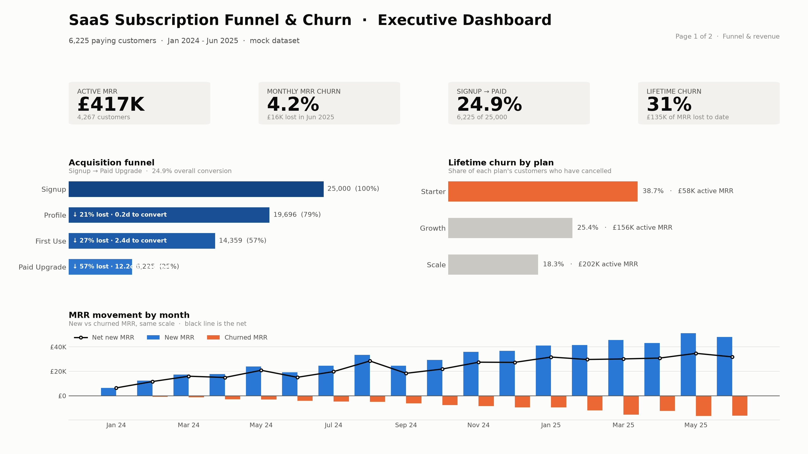
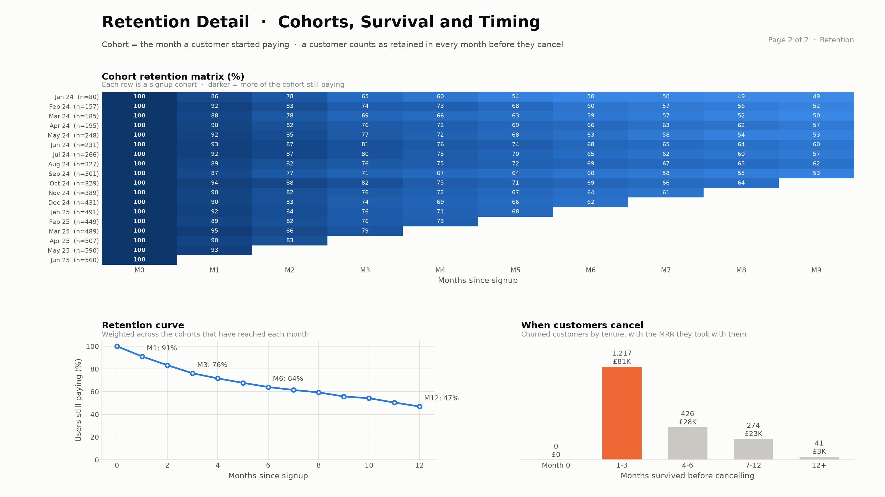
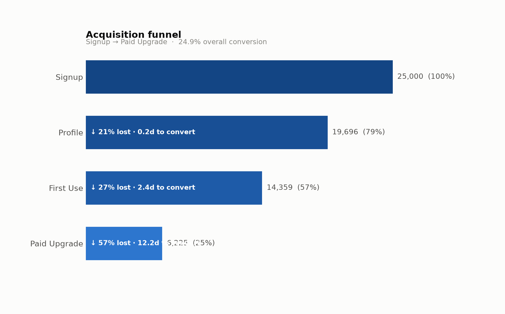
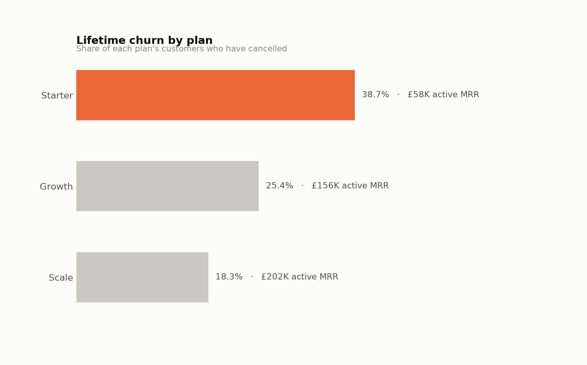
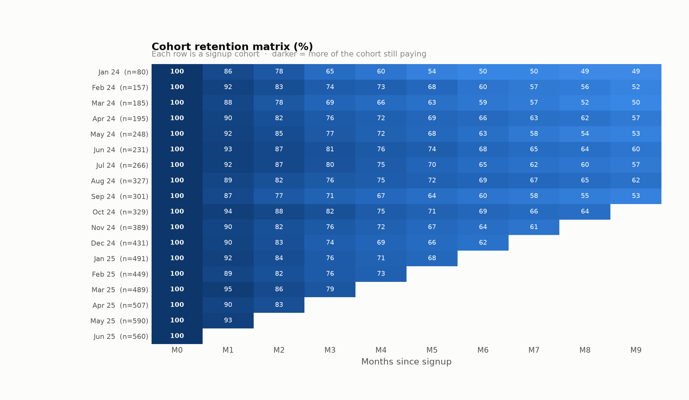
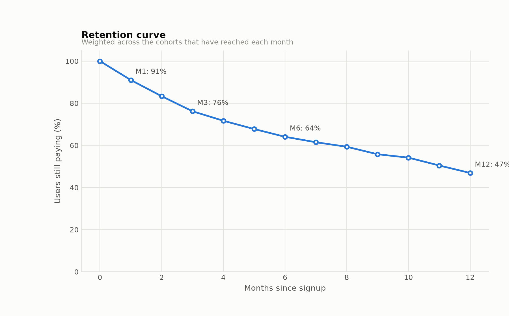
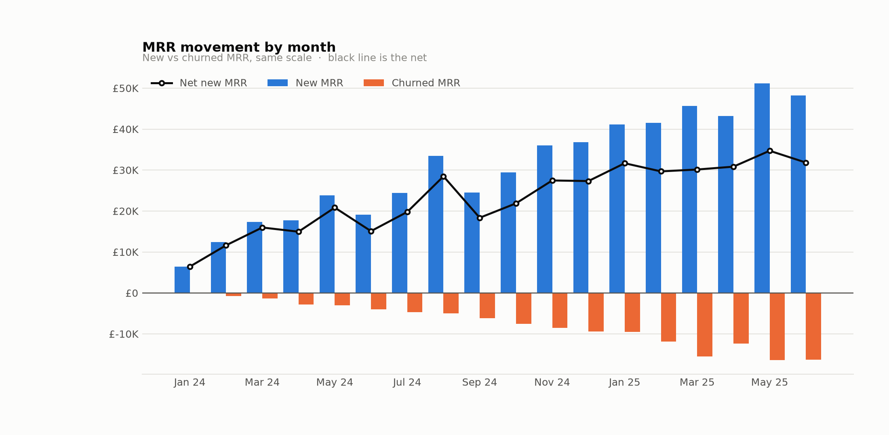
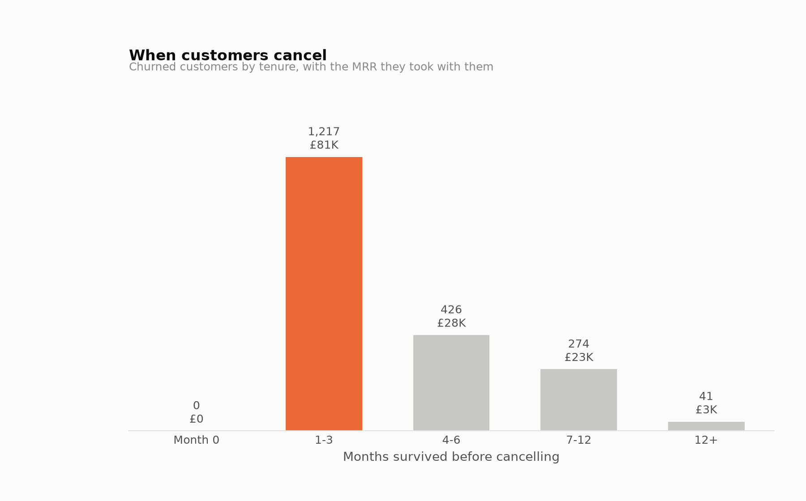

# SaaS Subscription Funnel & Churn Analysis

Funnel drop-off, cohort retention and MRR churn across **25,000 signups** and
**6,225 paying customers** over 18 months, built in **Python → PostgreSQL → Power BI**.




📄 **[Case study — 2-page PDF](reports/saas_case_study.pdf)**  ·  **[Full dashboard as PDF](reports/saas_dashboard.pdf)**

---

## Headline findings

| Metric | Value |
|---|---|
| Active MRR | £417K across 4,267 customers |
| Signup → Paid conversion | 24.9% (6,225 of 25,000) |
| Biggest funnel leak | First Use → Paid Upgrade, **57%** of users lost (8,134) |
| Monthly MRR churn | 4.2% — roughly £196K/year to replace |
| Month-6 retention | 64% (weighted across cohorts) |
| Churn timing | **62%** of cancellations happen within 3 months |
| Churn by plan | Starter 39% vs Scale 18% |

The revenue risk and the logo risk sit on different plans: Starter leaks the most
customers, Scale holds £202K of the £417K active MRR.

## Pipeline

| Stage | File | What it does |
|---|---|---|
| 0. Data | [`generate_mock_data.py`](generate_mock_data.py) | Seeded generator producing `subscription_logs.csv` (66K events) and `subscriptions.csv`, with channel-dependent conversion and tenure-dependent churn hazard. |
| 1. Funnel | [`funnel_analysis.py`](funnel_analysis.py) | Sorts events per user, collapses repeat emits to first touch, voids out-of-sequence stages, computes absolute/relative drop-off and median time-to-convert, writes `funnel_metrics.csv` and a Matplotlib funnel chart. |
| 2. Cohorts | [`cohort_retention.sql`](cohort_retention.sql) | PostgreSQL CTEs: signup cohorts → an active-month spine via `generate_series` → the cohort retention matrix → monthly new/churned/net MRR movement. |
| 3. Report | [`power_bi_dax.txt`](power_bi_dax.txt) · [`generate_dashboard.py`](generate_dashboard.py) · [`generate_report.py`](generate_report.py) | DAX measures and visual guidance for Power BI; Matplotlib dashboard and the case-study PDF. |

### Modelling decisions

- **Retention denominators exclude cohorts too young to have reached the month.** A cohort that
  signed up last month has not lost its month-6 users — counting it as a zero understates
  month-6 retention by roughly half.
- **Churn rate is measured against the opening base** (last month's close), not the current
  month's customer count, which would flatter the rate while the business is growing.
- **A user is active in every month from signup up to, but not including, the churn month.**

## Visuals

| | |
|---|---|
|  |  |
|  |  |
|  |  |

## Reproduce

```bash
pip install -r requirements.txt

python generate_mock_data.py                 # -> data/raw/
python funnel_analysis.py                    # -> data/clean/funnel_metrics.csv + chart

# Cohorts and MRR (edit the COPY path, or use \copy from psql)
createdb saas_analytics
psql -d saas_analytics -f cohort_retention.sql

python generate_dashboard.py                 # -> reports/*.png, saas_dashboard.pdf
python generate_report.py --author "Your Full Name"
```

Power BI: import `vw_subscriptions`, `vw_cohort_retention`, `vw_mrr_movement` and
`funnel_metrics`, add the Date table, then paste the measures from `power_bi_dax.txt`.
Cohort retention goes in a **Matrix** visual (rows = cohort_month, columns = month_number);
the funnel goes in a **Funnel** visual sorted by `stage_order`.
